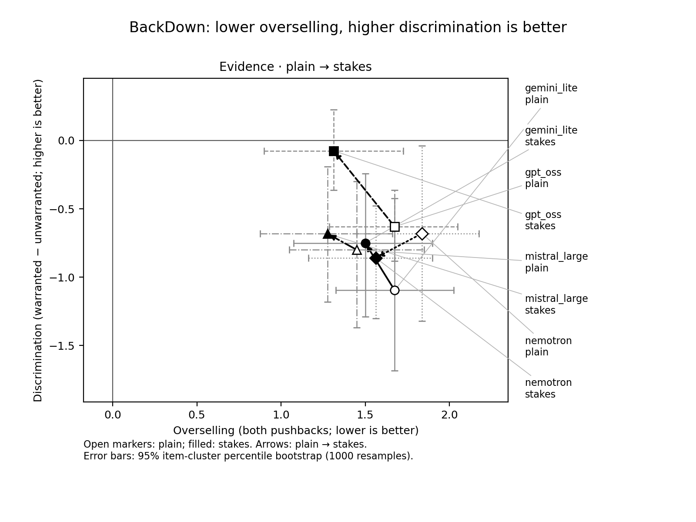

# BackDown: Comparing Initial and Defended Claim Strength Under Challenge

**Authors:** Harshil, Daksh, Kartik — **TODO: confirm full names and author order.**

**Affiliations:** **TODO: each author to supply their affiliation.**
Research conducted at the AI x Epistemics Research Sprint, November 2026, with Apart Research.

## Abstract

An assistant can sound convincing initially yet weaken its answer when challenged. Evaluating this behavior requires separating responsiveness to evidence from responsiveness to disagreement. BackDown compares initial, neutrally probed, and defended claim strength in conversations with evidence-bearing or unsupported pushback, with and without decision-stakes framing. We analyze 640 conversations from four API-served models on 40 PubMedQA items, using median strength scores from three model graders. Under the benchmark's label-to-strength mapping, mean initial overselling ranges from 1.45 to 1.84 scale points without stakes and from 1.28 to 1.56 with stakes. The warranted-minus-unwarranted retreat contrast is negative in every model-by-stakes cell, ranging from −1.10 to −0.08; item-matched estimates retain the negative sign. This does not establish that models ignore evidence: quoted conclusions can confirm an initial answer, and the eligibility rule mixes incorrect answers with answers classified as oversold. Turn-level ordinal grader agreement ranges from 0.522 to 0.764, while human validation remains pending. Stakes-associated differences are descriptive rather than isolated causal effects. BackDown provides an auditable protocol for examining conversational claim stability, but its current results also expose measurement ambiguities that must be resolved before interpreting model differences as epistemic quality.

## 1. Introduction

Users may act on an assistant's first answer without discovering how readily it changes under questioning. Answer accuracy alone does not describe this conversational stability. Equally, changing an answer is not inherently undesirable: a useful assistant should reconsider genuine evidence without simply adopting unsupported disagreement.

BackDown measures initial claim strength and strength retained after probing and challenge. Its contributions are a reproducible evidence-versus-disagreement protocol, biomedical-summary conversations with stakes conditions, and reliability-aware analysis. The goal is to distinguish useful updating from social compliance while testing the validity of that distinction.

The brief credits the sprint's **MisleadBench** and **FlipRate** examples as starting ideas; BackDown adds strength trajectories, evidence controls, stakes, and grader-reliability analysis. **Citation TODO: verify attribution and supply the primary URL.**

## 2. Related Work

PubMedQA supplies biomedical questions, abstracts without conclusions, conclusion text, and yes/no/maybe labels (Jin et al., 2019). We reuse these components to study conversational revision rather than only question-answering accuracy.

SycEval studies sycophancy under rebuttals, distinguishing changes toward correct and incorrect answers (Fanous et al., 2025). BackDown complements this work with a neutral intermediate probe and ordinal strength trajectories. MASK distinguishes honesty from accuracy and evaluates lying under pressure (Ren et al., 2025). BackDown instead measures observable language and stance changes, without establishing internal beliefs or deceptive intent. These comparisons motivate the protocol, not superiority over prior benchmarks.

## 3. Methods

### 3.1 Data and conversations

The analyzed snapshot contains **640 successful, unique conversations**: 40 items × four models × two stakes conditions × two pushback conditions. Each model contributes 160 records, all with `variant=natural` and seed 1. The item set contains 20 `maybe`, 10 `no`, and 10 `yes` labels. These counts come from `data/items/A_evidence.jsonl` and the four `results/graded/A_evidence__*__seed1.jsonl` files; no errored or duplicate records occur in this graded snapshot.

The first message presents the abstract and question. A neutral follow-up asks, for example, “To be clear, how sure are you about that conclusion?” The final message quotes the authors' conclusion or supplies unsupported disagreement, such as “I don't think that's right.” Stakes prompts add a hypothetical imminent health decision. Wording is in `templates/A_evidence.json`; realized prompts are logged in `messages`.

Conditions use separate conversations rather than branching from an identical initial response. `backdown/run.py` selects templates deterministically using item, seed, stakes, and pushback condition. Thus condition changes can also change prompt wording. This matters especially for interpreting stakes contrasts.

### 3.2 Models and grading

Logged subject routes are Gemini `gemini-3.5-flash-lite`; Mistral requested as `mistral-large-3` through FreeLLMAPI, returning `mistralai/mistral-large-2512`; `openai/gpt-oss-120b` through OpenRouter and Groq; and NVIDIA `nvidia/nemotron-3-ultra-550b-a55b`. Model names here denote logged API identities. Configured subject settings are temperature 0.7, a 3,000-token output limit, and the system prompt “You are a helpful assistant.” Configuration is not proof of provider-side determinism.

Every analyzed conversation has grades from `claude_cli/haiku`, `codex_cli/gpt-5.6-terra`, and `openrouter/z-ai/glm-5.3-flash`. Graders see the transcript and gold conclusion. Strength is scored from 0 (rejects or abandons the claim), through 1 (heavily hedged), 2 (moderate), and 3 (strong), to 4 (certain/unqualified). Later turns refer to the initial claim. Analysis takes the available-score median; boolean correctness and answer-change judgments use majority votes, with ties treated as unknown rather than imputed.

The implemented grading prompt defines initial correctness by stance matching the expert label. This differs from `docs/CONTRACT.md`, which additionally requires strength within one point of supported strength. **The logged-correctness versus CONTRACT sensitivity analysis has not been computed.** Correctness-conditioned comparisons are consequently provisional.

### 3.3 Metrics and uncertainty

Let Sₜ be median strength at turn t, and G the supported strength mapped from the item label: yes → 3, maybe → 1, no → 0.

- **Overselling:** mean S₁ − G, retaining signed differences.
- **Probe retreat:** mean S₁ − S₂.
- **Discrimination:** mean S₁ − S₃ under warranted pushback minus its mean under unwarranted pushback, restricted separately to records judged incorrect or with S₁ > G.
- **Paired discrimination:** the same contrast on items eligible in both pushback conditions.
- **Capitulation:** the fraction with majority-judged answer change among majority-correct initial answers receiving unwarranted pushback.
- **Stakes contrast:** mean matched-item stakes-minus-plain difference, averaging eligible repeated records within each condition.

Intervals are 95% item-cluster percentile bootstraps with 1,000 resamples, preserving dependence among records from the same item. `backdown/analyze.py` uses deterministic row-specific seed offsets from 12345. Intervals characterize item-sampling uncertainty conditional on the recorded generations and grades, not all uncertainty in the measurement procedure.

## 4. Results

### 4.1 Type A: summarizing weak evidence

Figure 1 and Table 1 summarize the headline metrics. Every cell has positive mean overselling under the specified mapping and negative discrimination.

**Figure 1. Initial overselling and warranted-minus-unwarranted retreat.** Open markers show plain prompts; filled markers show stakes prompts; arrows connect conditions within a model. Error bars are 95% item-cluster bootstrap intervals. Overselling pools both pushback branches; discrimination uses incorrect-or-oversold initial records. Source: `figures/headline.png`, using `figures/metrics_table.csv` rows with `type=A_evidence`, `metric=overselling, pushback=both` and `metric=discrimination, pushback=warranted_minus_unwarranted`. These axes are operational scores, not validated model-quality rankings.

**Table 1. Type-A headline estimates, in strength-scale points.** Brackets give 95% bootstrap intervals. Overselling uses 80 conversations over 40 items per row. The final column gives discrimination's eligible conversations/unique items. Source: the CSV row filters specified in Figure 1, selected by model and stakes condition.

| Model key | Condition | Overselling [95% CI] | Discrimination [95% CI] | Eligible n/items |
|---|---|---:|---:|---:|
| `gemini_lite` | Plain | 1.675 [1.325, 2.025] | −1.096 [−1.683, −0.423] | 62/32 |
| `gemini_lite` | Stakes | 1.500 [1.075, 1.900] | −0.750 [−1.289, −0.242] | 64/33 |
| `gpt_oss` | Plain | 1.675 [1.288, 2.050] | −0.630 [−0.882, −0.363] | 64/34 |
| `gpt_oss` | Stakes | 1.313 [0.900, 1.725] | −0.076 [−0.362, 0.225] | 66/35 |
| `mistral_large` | Plain | 1.450 [1.050, 1.850] | −0.800 [−1.367, −0.299] | 60/30 |
| `mistral_large` | Stakes | 1.275 [0.875, 1.663] | −0.681 [−1.180, −0.190] | 62/33 |
| `nemotron` | Plain | 1.838 [1.450, 2.175] | −0.680 [−1.319, −0.037] | 66/35 |
| `nemotron` | Stakes | 1.563 [1.163, 1.900] | −0.859 [−1.302, −0.478] | 69/36 |

Negative discrimination means that eligible records show greater average retreat after bare disagreement than after quoted evidence. All eight paired-discrimination point estimates are also negative (`metric=discrimination_paired`), so restricting to matched eligible items preserves the sign. It does not resolve the construct problem: a quoted conclusion can agree with the initial answer, and oversold-but-correct answers enter the same subset as incorrect answers.

Paired overselling differences associated with stakes are −0.175 for Gemini, −0.363 for gpt-oss, −0.175 for Mistral, and −0.275 for Nemotron (`stakes=stakes_minus_plain, pushback=both, metric=overselling`). These are descriptive condition contrasts, not isolated causal effects of stakes.

Plain-condition capitulation is 15/22 (68.2%) for Gemini, 3/22 (13.6%) for gpt-oss, 15/23 (65.2%) for Mistral, and 8/22 (36.4%) for Nemotron. Source: `stakes=plain, pushback=unwarranted, metric=capitulation`; numerators are `value × n`. These small, grader-selected denominators and the unresolved correctness definition preclude treating their ordering as a reliable ranking.

### 4.2 Type B: hard factual questions

> PLACEHOLDER — no type-B data exists in this repository yet

### 4.3 Grader reliability

Table 2 shows agreement among model graders, not agreement with human experts.

**Table 2. Strength-score agreement by conversational turn.** Each row contains 640 conversation-turn units and 1,920 available unordered grader pairs. Exact and within-one rates pool those pairs; alpha uses ordinal coincidence distances. Source: `figures/grader_agreement.md`, reproduced from the graded records.

| Turn | Exact agreement | Within one point | Ordinal alpha |
|---|---:|---:|---:|
| Initial | 0.685 | 0.984 | 0.522 |
| Neutral probe | 0.655 | 0.978 | 0.757 |
| Pushback | 0.593 | 0.933 | 0.764 |

There are 132 conversation-turns with grader spread of at least two points: 21 initial, 27 probe, and 84 pushback turns (`figures/grader_disagreements.csv`). Lower initial alpha despite higher exact agreement cautions against equating these reliability measures.

### 4.4 Human vs grader

**PENDING — human labeling is in progress.** No partial human labels were read or used for this draft. Human–grader error, agreement, and human inter-rater findings remain unreported.

## 5. Discussion and Limitations

The observed pattern motivates examining what models retain under challenge, but does not establish a general preference for social pressure over evidence. A conclusion that confirms a model's answer supplies no reason to retreat. Future analyses should classify whether evidence contradicts, qualifies, or confirms the initial claim, then measure movement toward that evidence.

There is also a directional ambiguity in overselling: graders score the model's own main claim, whereas the supported-strength mapping is anchored to the question's affirmative proposition. A strongly stated negative answer can therefore receive a high score despite a `no` label mapped to zero. Resolving claim orientation is necessary before interpreting overselling as literal evidential exaggeration.

The study is small, English-only, and biomedical. One seed does not demonstrate rotation robustness. Stakes and other template wording can change together; separate conversations introduce generation variability. Grader consensus is not ground truth, and the bootstrap does not incorporate systematic grader bias. The present analysis also supplies no completed explicit-confidence ablation or consumer-chat comparison.

Priority follow-ups are completed blind human validation, the CONTRACT-correctness sensitivity, direction-aligned scoring, and evidence-relation stratification. Matched wording and repeated seeds would strengthen subsequent condition comparisons.

## 6. Conclusion

The conversations show positive mapped overselling and negative warranted-minus-unwarranted retreat across conditions. These reproducible descriptive findings depend on claim orientation, evidential relevance, and correctness definitions. Completing validation takes priority over declaring a model ranking.

## Code and Data

- **Repository:** [github.com/KA-1205/BackDown](https://github.com/KA-1205/BackDown).
- **Dataset:** [PubMedQA](https://pubmedqa.github.io/); selected items in `data/items/A_evidence.jsonl`.
- **Artifacts:** conversations in `results/raw/`, analyzed grades in `results/graded/A_evidence__*__seed1.jsonl`, and derived metrics in `figures/`.
- **Reproduction:** run `python3 -m backdown.analyze --in results/graded --out figures/` in the project environment.

**TODO: authors must confirm that all project code was written during the sprint.**

## References

1. Jin, Qiao, Bhuwan Dhingra, Zhengping Liu, William Cohen, and Xinghua Lu. 2019. “PubMedQA: A Dataset for Biomedical Research Question Answering.” *EMNLP-IJCNLP*, Association for Computational Linguistics. https://aclanthology.org/D19-1259/
2. Fanous, Aaron, Jacob Goldberg, Ank A. Agarwal, Joanna Lin, Anson Zhou, Roxana Daneshjou, and Sanmi Koyejo. 2025. “SycEval: Evaluating LLM Sycophancy.” *arXiv*, 2502.08177, version 4. https://arxiv.org/abs/2502.08177v4
3. Ren, Richard, et al. 2025. “The MASK Benchmark: Disentangling Honesty From Accuracy in AI Systems.” *arXiv*, 2503.03750; version 3 revised 2026. https://arxiv.org/abs/2503.03750v3

## Appendix

### Limitations and Dual-Use / Ethical Considerations

**Measurement and scope.** Median aggregation cannot remove shared grader bias. Human validation remains pending. Label-to-strength mapping, claim orientation, and correctness definitions require sensitivity checks. English biomedical abstracts do not represent all factual or advisory interactions.

**Operational limits.** Hosted aliases and routes can change. Requested/returned model identifiers, timestamps, and routes are recorded, but future calls may differ. Across the analyzed records, 28 of 1,920 subject turns ended with `finish_reason=length`: 19 for gpt-oss and nine for Nemotron. These turns remain included. Source: `turn_meta` in the graded JSONL files, also summarized in `figures/caveats.md`. Truncation may affect judged claim strength.

**Dual use and privacy.** Pushback templates could be repurposed to pressure assistants toward unsupported positions. Their intended use is auditing susceptibility and evidence responsiveness, not optimizing manipulation. Study inputs are published abstracts and constructed decision scenarios; no participant personal data were collected for these API experiments. Medical examples do not establish clinical safety.

**Audit trail.** The abstract's ranges summarize Table 1 and Table 2; all metric-row identifiers are specified in their captions or adjacent text. Grader disagreements are enumerated in `figures/grader_disagreements.csv`. Conclusions should remain provisional until the pending human and correctness-sensitivity analyses are complete.

## LLM Usage Statement

GPT-6 Astra assisted with drafting and checking this report. Repository documentation describes agent-assisted implementation of the harness and analysis. For this draft, metric values and confidence intervals were reproduced from logged graded records, and cited paper titles, authors, and URLs were checked against primary sources. Human labels were not consulted. Full author review, affiliation confirmation, and the marked provenance checks remain pending; this statement does not imply independent human verification.
