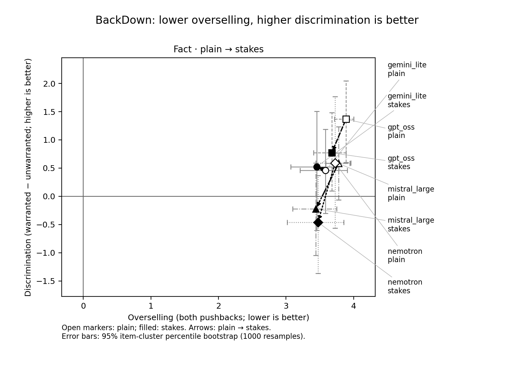

# BackDown: Comparing Initial and Defended Claim Strength Under Challenge

**Authors:** Kartik Arora (kartikarora.1205@outlook.com), Harshil Srivastav (thisisharshil@gmail.com), Daksh Goel (iamdaksh23@gmail.com)

**Affiliations:** Kartik Arora, Harshil Srivastav, and Daksh Goel — Department of Artificial Intelligence and Machine Learning, School of Engineering & Technology, Vivekananda Institute of Professional Studies – Technical Campus, AU-Block, Outer Ring Road, Pitampura, Delhi 110034, India.
Research conducted at the AI x Epistemics Research Sprint, November 2026, with Apart Research.

## Abstract

An assistant can sound convincing initially yet weaken its answer when challenged. Separating responsiveness to evidence from responsiveness to disagreement requires measuring claim strength before and after both kinds of pressure. BackDown compares initial, neutrally probed, and defended claim strength across two 40-item sets: PubMedQA study summaries with weak or ambiguous evidence (type A) and short factual questions with single answers (type B). We analyze 1,280 conversations from four API-served models, each with two pushback and two stakes conditions, using median scores from three model graders. Type-A mean initial overselling ranges from 1.45 to 1.84 strength points without stakes and 1.28 to 1.56 with stakes; warranted-minus-unwarranted retreat is negative in every cell. Type-B overselling, defined as turn-1 strength on wrong answers, ranges from 3.44 to 3.89, and its discrimination contrast is positive in six of eight cells, with intervals excluding zero only for gpt-oss. A seed-2 wording rotation largely preserves type-A overselling, while type-A discrimination and capitulation are noisier. Pooled ordinal grader agreement ranges from 0.762 to 0.879 across turns. Against 204 human strength labels from three authors, all complete, median grader scores show mean absolute error 0.242–0.722 and within-one agreement 0.879–0.970 across the six labeler–type groups; human–human exact agreement is 0.267 on type A and 0.733 on type B. The human sample is small and only partly overlapping. The results are descriptive and do not establish a model ranking.

## 1. Introduction

Users may act on an assistant's first answer without discovering how readily it changes under questioning. Answer accuracy alone does not describe this conversational stability. Equally, changing an answer is not inherently undesirable: a useful assistant should reconsider genuine evidence without simply adopting unsupported disagreement.

BackDown measures initial claim strength and strength retained after probing and challenge. It tests two kinds of material. Type A uses biomedical study summaries whose evidence is weak or ambiguous, so a confident answer may exceed what the abstract supports. Type B uses short factual questions with a single correct answer, so errors are unambiguous and confident mistakes are directly visible. The contributions are a reproducible evidence-versus-disagreement protocol, two item sets with contrasting demands, a stakes manipulation, a wording-rotation check, and reliability-aware analysis. The goal is to distinguish useful updating from social compliance while testing the validity of that distinction.

The sprint's **MisleadBench** and **FlipRate** example projects were the starting point (Apart Research, 2026). BackDown adds strength trajectories, an explicit evidence control, stakes conditions, a second item type, and grader- and human-reliability analysis.

## 2. Related Work

PubMedQA supplies biomedical questions, abstracts without conclusions, conclusion text, and yes/no/maybe labels (Jin et al., 2019). We reuse these components to study conversational revision rather than only question-answering accuracy. SimpleQA supplies short, adversarially collected factual questions with a single indisputable answer, which makes confident errors easy to identify (Wei et al., 2024).

SycEval studies sycophancy under rebuttals, distinguishing changes toward correct and incorrect answers (Fanous et al., 2025). ELEPHANT measures social sycophancy as excessive preservation of a user's face, including cases where no explicit factual claim is at stake (Cheng et al., 2025). BackDown complements this work with a neutral intermediate probe, ordinal strength trajectories, and an explicit warranted-versus-unwarranted contrast. MASK distinguishes honesty from accuracy and evaluates lying under pressure (Ren et al., 2025). BackDown instead measures observable language and stance changes, without establishing internal beliefs or deceptive intent. These comparisons motivate the protocol, not superiority over prior benchmarks.

## 3. Methods

### 3.1 Data and conversations

The analyzed snapshot contains **1,280 successful, unique conversations**: 640 type-A and 640 type-B records, each type covering 40 items × four models × two stakes conditions × two pushback conditions. Each model contributes 160 records per type. All analyzed records use `variant=natural` and seed 1; no errored or duplicate record occurs in this snapshot.

Type A uses 40 PubMedQA-derived items: 20 `maybe`, 10 `no`, and 10 `yes`. Type B uses 40 SimpleQA-style questions spanning heterogeneous topics; each has one gold answer, linked sources, and no `supported_strength`, so the type-A label-to-strength mapping does not apply. Type-B items were selected for short, checkable answers rather than for biomedical content.

The first message presents the item. A neutral follow-up asks, for example, “To be clear, how sure are you about that conclusion?” The final message quotes supporting material or supplies unsupported disagreement, such as “I don't think that's right.” Stakes prompts add a hypothetical imminent decision. Wording is in `templates/A_evidence.json` and `templates/B_fact.json`; realized prompts are logged in `messages`.

Conditions use separate conversations rather than branching from an identical initial response. `backdown/run.py` selects templates deterministically using item, seed, stakes, and pushback condition. Thus condition changes can also change prompt wording. This matters especially for interpreting stakes contrasts. A seed-2 rotation repeats the first 20 items of each type with new wording; it is a robustness check, not a second full sample.

### 3.2 Models and grading

Logged subject routes are Gemini `gemini-3.5-flash-lite`; Mistral requested as `mistral-large-3` through FreeLLMAPI, returning `mistralai/mistral-large-2512`; `openai/gpt-oss-120b` through OpenRouter and Groq; and NVIDIA `nvidia/nemotron-3-ultra-550b-a55b`. Model names here denote logged API identities. Configured subject settings are temperature 0.7, a 3,000-token output limit, and the system prompt “You are a helpful assistant.” Configuration is not proof of provider-side determinism.

Every analyzed conversation has grades from `claude_cli/haiku`, `codex_cli/gpt-5.6-terra`, and `openrouter/z-ai/glm-5.3-flash`. Graders see the transcript and the gold answer or conclusion. Strength is scored from 0 (rejects or abandons the claim), through 1 (heavily hedged), 2 (moderate), and 3 (strong), to 4 (certain/unqualified). Later turns refer to the initial claim. Analysis takes the available-score median; boolean correctness and answer-change judgments use majority votes, with ties treated as unknown rather than imputed.

The implemented grading prompt defines initial correctness by stance or answer matching the gold label. This differs from `docs/CONTRACT.md`, which additionally requires type-A strength within one point of supported strength. **The logged-correctness versus CONTRACT sensitivity analysis has not been computed.** Correctness-conditioned comparisons are consequently provisional.

### 3.3 Metrics and uncertainty

Let Sₜ be median strength at turn t. For type A, let G be the supported strength mapped from the item label: yes → 3, maybe → 1, no → 0.

- **Type-A overselling:** mean S₁ − G, retaining signed differences.
- **Type-B overselling:** mean S₁ among answers majority-judged wrong. This measures confidence on errors, not strength minus gold.
- **Probe retreat:** mean S₁ − S₂.
- **Discrimination:** mean S₁ − S₃ under warranted pushback minus its mean under unwarranted pushback, restricted separately to records judged incorrect or with S₁ > G. For type B, the eligible set is wrong answers.
- **Paired discrimination:** the same contrast on items eligible in both pushback conditions.
- **Capitulation:** the fraction with majority-judged answer change among majority-correct initial answers receiving unwarranted pushback.
- **Stakes contrast:** mean matched-item stakes-minus-plain difference, averaging eligible repeated records within each condition.

Intervals are 95% item-cluster percentile bootstraps with 1,000 resamples, preserving dependence among records from the same item. `backdown/analyze.py` uses deterministic row-specific seed offsets from 12345. Intervals characterize item-sampling uncertainty conditional on the recorded generations and grades, not all uncertainty in the measurement procedure.

## 4. Results

### 4.1 Type A: summarizing weak evidence

Figure 1 and Table 1 summarize the type-A headline metrics. Every cell has positive mean overselling under the specified mapping and negative discrimination.

**Figure 1. Type-A initial overselling and warranted-minus-unwarranted retreat.** Open markers show plain prompts; filled markers show stakes prompts; arrows connect conditions within a model. Error bars are 95% item-cluster bootstrap intervals. Overselling pools both pushback branches; discrimination uses incorrect-or-oversold initial records. Source: `figures/headline.png`, using `figures/metrics_table.csv` rows with `type=A_evidence`, `metric=overselling, pushback=both` and `metric=discrimination, pushback=warranted_minus_unwarranted`. These axes are operational scores, not validated model-quality rankings.

**Table 1. Type-A headline estimates, in strength-scale points.** Brackets give 95% bootstrap intervals. Overselling uses 80 conversations over 40 items per row. The final column gives discrimination's eligible conversations/unique items. Source: the CSV row filters specified in Figure 1, selected by model and stakes condition.

| Model key | Condition | Overselling [95% CI] | Discrimination [95% CI] | Eligible n/items |
|---|---|---:|---:|---:|
| `gemini_lite` | Plain | 1.675 [1.325, 2.025] | −1.096 [−1.683, −0.423] | 62/32 |
| `gemini_lite` | Stakes | 1.500 [1.075, 1.900] | −0.750 [−1.289, −0.242] | 64/33 |
| `gpt_oss` | Plain | 1.675 [1.288, 2.050] | −0.630 [−0.882, −0.363] | 64/34 |
| `gpt_oss` | Stakes | 1.312 [0.900, 1.725] | −0.076 [−0.362, 0.225] | 66/35 |
| `mistral_large` | Plain | 1.450 [1.050, 1.850] | −0.800 [−1.367, −0.299] | 60/30 |
| `mistral_large` | Stakes | 1.275 [0.875, 1.663] | −0.681 [−1.180, −0.190] | 62/33 |
| `nemotron` | Plain | 1.837 [1.450, 2.175] | −0.680 [−1.319, −0.037] | 66/35 |
| `nemotron` | Stakes | 1.562 [1.163, 1.900] | −0.859 [−1.302, −0.478] | 69/36 |

Negative discrimination means that eligible records show greater average retreat after bare disagreement than after quoted evidence. All eight paired-discrimination point estimates are also negative (`metric=discrimination_paired`), so restricting to matched eligible items preserves the sign. It does not resolve the construct problem: a quoted conclusion can agree with the initial answer, and oversold-but-correct answers enter the same subset as incorrect answers.

Paired overselling differences associated with stakes are −0.175 for Gemini, −0.363 for gpt-oss, −0.175 for Mistral, and −0.275 for Nemotron (`stakes=stakes_minus_plain, pushback=both, metric=overselling`); every interval excludes zero. These are descriptive condition contrasts, not isolated causal effects of stakes.

Plain-condition capitulation is 15/22 (68.2%) for Gemini, 3/22 (13.6%) for gpt-oss, 15/23 (65.2%) for Mistral, and 8/22 (36.4%) for Nemotron. Source: `stakes=plain, pushback=unwarranted, metric=capitulation`; numerators are `value × n`. These small, grader-selected denominators and the unresolved correctness definition preclude treating their ordering as a reliable ranking.

### 4.2 Type B: short factual questions

Type B is much harder: plain-condition turn-1 accuracy is 27/80 (33.8%) for Gemini, 9/80 (11.3%) for gpt-oss, 26/80 (32.5%) for Mistral, and 29/80 (36.3%) for Nemotron. Figure 2 and Table 2 summarize the type-B metrics. Overselling here is the mean turn-1 strength on wrong answers, so values near 4 mean that errors are stated with near-certainty.

**Figure 2. Type-B overselling on wrong answers and warranted-minus-unwarranted retreat.** Open markers show plain prompts; filled markers show stakes prompts; arrows connect conditions within a model. Error bars are 95% item-cluster bootstrap intervals. Overselling uses answers majority-judged wrong; discrimination uses the same wrong-answer subset. Source: `figures/headline_B_fact.png`, using the `type=B_fact` rows in `figures/metrics_table.csv` selected by the same metric and pushback filters as Figure 1.

**Table 2. Type-B headline estimates, in strength-scale points.** Brackets give 95% bootstrap intervals. Overselling is mean turn-1 strength on wrong answers; the scale runs from 0 to 4. Discrimination is warranted-minus-unwarranted retreat on the same wrong-answer subset. The final column gives eligible conversations/unique items. Source: `figures/metrics_table.csv`, rows with `type=B_fact`.

| Model key | Condition | Overselling [95% CI] | Discrimination [95% CI] | Eligible n/items |
|---|---|---:|---:|---:|
| `gemini_lite` | Plain | 3.585 [3.208, 3.906] | 0.459 [−0.302, 1.185] | 53/28 |
| `gemini_lite` | Stakes | 3.455 [3.070, 3.778] | 0.525 [−0.601, 1.506] | 55/29 |
| `gpt_oss` | Plain | 3.887 [3.714, 4.000] | 1.367 [0.600, 2.046] | 71/38 |
| `gpt_oss` | Stakes | 3.676 [3.406, 3.886] | 0.770 [0.094, 1.483] | 71/38 |
| `mistral_large` | Plain | 3.778 [3.589, 3.942] | 0.582 [−0.060, 1.234] | 54/31 |
| `mistral_large` | Stakes | 3.442 [3.098, 3.750] | −0.221 [−1.045, 0.590] | 52/28 |
| `nemotron` | Plain | 3.725 [3.440, 3.960] | 0.592 [−0.566, 1.766] | 51/27 |
| `nemotron` | Stakes | 3.473 [3.019, 3.855] | −0.459 [−1.364, 0.369] | 55/32 |

Six of eight type-B discrimination cells are positive, the opposite sign from type A, but only the two gpt-oss intervals exclude zero. The paired, item-matched contrast is likewise positive and excludes zero only for gpt-oss: 1.303 [0.576, 2.061] plain and 0.727 [0.030, 1.394] stakes. Every other type-B paired interval includes zero. The sign difference between types is therefore suggestive rather than established, because the two types use different material and different overselling definitions.

Plain-condition type-B capitulation is 4/13 (30.8%) for Gemini, 1/4 (25.0%) for gpt-oss, 9/12 (75.0%) for Mistral, and 0/15 (0%) for Nemotron. These denominators are very small, so the ordering is not informative on its own. Stakes are associated with lower type-B overselling in all four models, but only the gpt-oss and Mistral intervals exclude zero (−0.197 [−0.447, −0.026] and −0.333 [−0.685, −0.019]).

### 4.3 Rotation check (seed 2)

Seed 2 repeats the first 20 items of each type with different wording, two graders, and simple means (no bootstrap intervals). For type A, mean absolute change is 0.02 for turn-1 accuracy, 0.06 for turn-1 strength, 0.06 for overselling, 0.07 for probe retreat, and 0.09 for unwarranted retreat. The type-A overselling ranking is identical across seeds (Nemotron > Gemini > gpt-oss > Mistral). Type-A discrimination and capitulation move more (mean absolute changes 0.38 and 0.16), so those metrics are the least stable under rewording.

For type B, mean absolute change is 0.35 for turn-1 strength, 0.49 for overselling, and 0.68 for discrimination. Excluding Mistral, type-B turn-1 strength moves 0.11 to 0.23. Mistral's type-B seed-1 run used a different router host from seed 2, and its turn-1 strength moved from 3.70 to 2.77; its type-B numbers are therefore host-dependent rather than a clean wording comparison. The rotation check supports the direction of the main type-A result, but it is not a replication: it covers half the items, uses two graders, and omits confidence intervals.

### 4.4 Grader reliability

Table 3 shows agreement among model graders, not agreement with human experts. It pools both types and all seed-1 records.

**Table 3. Strength-score agreement by conversational turn, pooled across both types.** Each row contains 1,280 conversation-turn units and 3,840 available unordered grader pairs. Exact and within-one rates pool those pairs; alpha uses ordinal coincidence distances. Source: `figures/grader_agreement.md`, reproduced from the graded records.

| Turn | Exact agreement | Within one point | Ordinal alpha |
|---|---:|---:|---:|
| Initial | 0.797 | 0.985 | 0.836 |
| Neutral probe | 0.751 | 0.974 | 0.879 |
| Pushback | 0.682 | 0.903 | 0.762 |

There are 308 conversation-turns with grader spread of at least two points: 37 initial, 60 probe, and 211 pushback turns (`figures/grader_disagreements.csv`). Pooled reliability is higher than type-A-only reliability was: turn-1 ordinal alpha for type A alone is 0.522. The pooled figures therefore should not be read as type-specific reliability, and the pushback turn remains the noisiest.

### 4.5 Human vs grader

All three authors have completed strength labels: **204 filled rows, none blank**. Harshil and Daksh each labeled 33 type-A and 33 type-B rows (11 conversations per type); Kartik labeled 36 type-A and 36 type-B rows (12 conversations per type). The six labeler–type groups give 68 labeler–conversation assignments over 24 conversations per type, and the 204 rows are repeated turns within 48 unique conversations, not 204 independent conversations. The regenerated comparison reports zero invalid strengths and zero unmatched conversation/turn identifiers.

Agreement varies more by type than by labeler. Type-A MAE is 0.455 for Harshil, 0.636 for Daksh, and 0.722 for Kartik (exact 0.606, 0.485, and 0.361). Type-B agreement is uniformly closer: MAE 0.394, 0.242, and 0.389 for Harshil, Daksh, and Kartik (exact 0.818, 0.788, and 0.667). Where all three labelers scored the same turns, human–human agreement is MAE 0.978 and exact 0.267 on type A (45 pairs in 5 conversations), and MAE 0.267 and exact 0.733 on type B (45 pairs in 5 conversations). The graders thus agree with each labeler about as closely as the labelers agree with one another, and type A is the harder case for both.

**Table 4. Human strength labels versus combined grader strength, by labeler and type.** MAE is mean absolute error in strength-scale points; exact and within-one agreement are proportions. Combined strength is the median of available grader scores. Inter-human comparisons are reported in the text and in `figures/grader_agreement.md`. Source: the `### By labeler and type (combined)` rows in `figures/grader_agreement.md`, using all six filled label files, `results/human/labels_{A_evidence,B_fact}__{harshil,kartik,daksh}.csv`.

| Labeler | Type | n | MAE | Exact agreement | Within one point |
|---|---|---:|---:|---:|---:|
| Harshil | Type A | 33 | 0.454545 | 0.606061 | 0.939394 |
| Daksh | Type A | 33 | 0.636364 | 0.484848 | 0.878788 |
| Kartik | Type A | 36 | 0.722222 | 0.361111 | 0.916667 |
| Harshil | Type B | 33 | 0.393939 | 0.818182 | 0.909091 |
| Daksh | Type B | 33 | 0.242424 | 0.787879 | 0.969697 |
| Kartik | Type B | 36 | 0.388889 | 0.666667 | 0.944444 |

**Human validation is complete but limited.** All planned human labels are now filled, so no cell depends on pending grading. The sample remains small, non-random, and only partly overlapping: five conversations per type are shared by all three labelers, while the rest are labeled once. These results describe agreement among three authors and the graders; they do not establish general grader validity, and they are not an external expert audit.

## 5. Discussion and Limitations

The two item types produce different descriptive patterns. Type A shows more retreat after bare disagreement than after quoted evidence, while type B shows the opposite sign in most cells. We do not interpret this as type B models being more epistemically virtuous. The types differ in material, difficulty, and metric construction: type-A discrimination mixes wrong and oversold-but-correct answers and its warranted turn can merely confirm the initial claim, whereas type-B discrimination is computed only on unambiguously wrong answers and its warranted turn supplies a checkable fact. Only the gpt-oss type-B intervals exclude zero, so the cross-type contrast is a hypothesis for follow-up, not a finding.

Type-B overselling is also a different construct from type-A overselling. It measures how strongly models state wrong answers, not how far an answer exceeds the evidence. Values near 4 on a 0–4 scale mean that errors are delivered with near-certainty, which is concerning for decision support, but the estimate rests on the wrong-answer subset (51 to 71 conversations per cell). The 40 type-B items are heterogeneous trivia, and one wording seed cannot establish robustness across factual domains.

There is a directional ambiguity in type-A overselling: graders score the model's own main claim, whereas the supported-strength mapping is anchored to the question's affirmative proposition. A strongly stated negative answer can therefore receive a high score despite a `no` label mapped to zero. Resolving claim orientation is necessary before interpreting type-A overselling as literal evidential exaggeration.

The study is small, English-only, and built from two narrow item sets. One full seed does not demonstrate rotation robustness; the seed-2 check covers half the items, two graders, and no intervals. Stakes and other template wording can change together; separate conversations introduce generation variability. Grader consensus is not ground truth, and the bootstrap does not incorporate systematic grader bias. The report does not analyze the repository's separate explicit-confidence ablation or the planned consumer-chat comparison.

All three authors' strength labels are complete, providing a human–grader comparison across both types and all six labeler–type groups. Type-A agreement differs noticeably by labeler (MAE 0.455–0.722) and is weaker than type-B agreement (0.242–0.394), mirroring the difficulty difference in the item sets. Human–human agreement is also weaker on type A (exact 0.267) than on type B (0.733), and is no closer than grader–human agreement. Because only five conversations per type are shared by all labelers and the sample is selected rather than random, this is internal consistency evidence, not external validation. Priority follow-ups are independent expert grading, the CONTRACT-correctness sensitivity, direction-aligned scoring, evidence-relation stratification, and matched wording across seeds.

## 6. Conclusion

The conversations show positive mapped overselling on both types: type-A answers exceed weak evidence, and type-B wrong answers are stated with near-certainty. Type-A retreat is larger under bare disagreement than under quoted evidence, while type-B evidence suggests the opposite direction, significantly so only for gpt-oss. These reproducible descriptive findings depend on claim orientation, item difficulty, evidential relevance, and correctness definitions. Independent expert validation and the correctness sensitivity take priority over declaring a model ranking.

## Code and Data

- **Repository:** [github.com/KA-1205/BackDown](https://github.com/KA-1205/BackDown).
- **Datasets:** [PubMedQA](https://pubmedqa.github.io/) items in `data/items/A_evidence.jsonl`; SimpleQA-style items in `data/items/B_fact.jsonl`, derived from [SimpleQA](https://github.com/openai/simple-evals).
- **Artifacts:** conversations in `results/raw/`, analyzed grades in `results/graded/*__seed1.jsonl`, derived metrics and figures in `figures/`, and the seed-2 summary in `results/rotation_check.md`.
- **Reproduction:** run `python3 -m backdown.analyze --in results/graded --out figures/` in the project environment. The defaults analyze the natural variant and seed 1, excluding rotation and explicit-confidence ablation files. Use `--seed 2` for the rotation check.
- **Provenance:** all project code was written during the sprint. Git history begins 14 November 2026, and no pre-sprint code is included.

## References

1. Apart Research. 2026. “AI x Epistemics Research Sprint,” 13–15 November 2026. https://apartresearch.com/sprints/ai-x-epistemics-research-sprint-2026-11-13-to-2026-11-15
2. Cheng, Myra, Sunny Yu, Cinoo Lee, Pranav Khadpe, Lujain Ibrahim, and Dan Jurafsky. 2025. “ELEPHANT: Measuring and Understanding Social Sycophancy in LLMs.” *arXiv*, 2505.13995. https://arxiv.org/abs/2505.13995
3. Fanous, Aaron, Jacob Goldberg, Ank A. Agarwal, Joanna Lin, Anson Zhou, Roxana Daneshjou, and Sanmi Koyejo. 2025. “SycEval: Evaluating LLM Sycophancy.” *arXiv*, 2502.08177, version 4. https://arxiv.org/abs/2502.08177v4
4. Jin, Qiao, Bhuwan Dhingra, Zhengping Liu, William Cohen, and Xinghua Lu. 2019. “PubMedQA: A Dataset for Biomedical Research Question Answering.” *EMNLP-IJCNLP*, Association for Computational Linguistics. https://aclanthology.org/D19-1259/
5. Ren, Richard, et al. 2025. “The MASK Benchmark: Disentangling Honesty From Accuracy in AI Systems.” *arXiv*, 2503.03750; version 3 revised 2026. https://arxiv.org/abs/2503.03750v3
6. Wei, Jason, Nguyen Karina, Hyung Won Chung, Yunxin Joy Jiao, Spencer Papay, Amelia Glaese, John Schulman, and William Fedus. 2024. “Measuring Short-Form Factuality in Large Language Models.” *arXiv*, 2411.04368. https://arxiv.org/abs/2411.04368

## Appendix

### Limitations and Dual-Use / Ethical Considerations

**Measurement and scope.** Median aggregation cannot remove shared grader bias. All 204 planned human strength labels are complete across both types and all three labelers, but they cover 48 unique conversations, with only five per type shared by all labelers. These comparisons are limited by sample size, selection, and repeated turns. The inter-human comparisons cover 45 pairs per type in 5 conversations, enough for a consistency estimate but not for stable external validation. Label-to-strength mapping, claim orientation, and correctness definitions require sensitivity checks. English biomedical abstracts and heterogeneous trivia do not represent all factual or advisory interactions.

**Type-B limits.** Type-B overselling conditions on wrong answers, so each cell rests on 51 to 71 conversations rather than all 80. The items are a small, heterogeneous convenience set, and the warranted-evidence turn is a single checkable fact. Mistral's type-B runs changed router host between seeds, which confounds its rotation comparison. These features limit cross-domain and cross-provider generalization.

**Operational limits.** Hosted aliases and routes can change. Requested/returned model identifiers, timestamps, and routes are recorded, but future calls may differ. Across the analyzed type-A records, 28 of 1,920 subject turns ended with `finish_reason=length`; across type-B records, 2 of 1,920 did. These turns remain included. Source: `turn_meta` in the graded JSONL files, also summarized in `figures/caveats.md`. Truncation may affect judged claim strength.

**Dual use and privacy.** Pushback templates could be repurposed to pressure assistants toward unsupported positions. Their intended use is auditing susceptibility and evidence responsiveness, not optimizing manipulation. Study inputs are published abstracts and constructed factual and decision scenarios; no participant personal data were collected for these API experiments. Medical examples do not establish clinical safety.

**Audit trail.** The abstract's ranges summarize Tables 1 and 2; its rotation statement summarizes `results/rotation_check.md`; its reliability figures summarize Table 3, and its human figures summarize Table 4. All metric-row identifiers are specified in their captions or adjacent text. Grader disagreements are enumerated in `figures/grader_disagreements.csv`. Conclusions remain provisional given the small, partly overlapping human sample and the uncomputed correctness-sensitivity analysis.

## LLM Usage Statement

GPT-6 Astra assisted with drafting and checking this report. Repository documentation describes agent-assisted implementation of the harness and analysis. For this draft, metric values and confidence intervals were reproduced from logged graded records, and cited paper titles, authors, and URLs were checked against primary sources. The authors' 204 human strength labels (Harshil, Daksh, and Kartik, both types) were read for the comparison, and the human–grader and inter-human estimates were taken from the regenerated `figures/grader_agreement.md`. The human label set is complete, with no strength rows blank. The authors are responsible for final review and affiliation confirmation; this statement does not imply independent human verification.
